# AI-Powered Retail Sales Forecasting & Inventory Optimization System

A beginner-friendly, reproducible student project that turns daily store/product sales into chronological demand forecasts and transparent replenishment recommendations. It runs offline using a seeded synthetic dataset; it does not claim real-world savings or production readiness.

## Business problem and objectives

Retail planners must estimate demand and decide when and how much to replenish while accounting for supplier lead time and uncertainty. This project demonstrates demand forecasting, baseline comparison, stockout visibility, safety stock, reorder points, EOQ, and purchase-order export using an explainable local workflow.

## Features and industry relevance

- Reproducible multi-store, multi-product daily sales simulation with trend, weekly pattern, promotions, intermittent products and simulated inventory.
- Input checks and a data-quality summary, including duplicate keys, zero sales and stockout observations.
- Leakage-aware calendar, lag and shifted rolling features.
- Seasonal Naive and Random Forest forecasts, plus Croston SBA for sparse demand.
- Chronological holdout evaluation using MAE, RMSE and MASE (when defined).
- Forecast horizon selection, inventory planning, CSV purchase-order export and Streamlit dashboard.
- Actual generated data-derived charts, CSV outputs and pytest checks.

These are common planning techniques, implemented as an educational simulation rather than a live retail decision service.

## Technology stack

Python 3.13 (supported project range 3.12–3.13), pandas, NumPy, scikit-learn, SciPy, Matplotlib, Seaborn, Streamlit and pytest. A GPU, cloud service, API key and paid service are not required.

## Architecture and data flow

`data/sample/retail_sales.csv` or optional `data/raw/retail_sales.csv` → validated pandas data → time-safe features and chronological metrics → dated forecast and inventory recommendation tables → CSV/PNG outputs and dashboard. See [docs/architecture.md](docs/architecture.md).

## Dataset

The included sample is generated locally by `src/retail_forecasting/simulation.py` with seed 42; it is synthetic, not a public dataset, and has no external dataset license. It simulates 3 stores × 8 products × 730 daily dates. Stockouts are flagged and observed sales on those days may understate latent demand; lost sales are not imputed. See [docs/data_dictionary.md](docs/data_dictionary.md) and [docs/assumptions.md](docs/assumptions.md).

To use your own CSV, place it at `data/raw/retail_sales.csv`; both the pipeline and dashboard prefer it over the generated sample. At minimum it needs `date`, `store_id`, `item_id`, and `qty_sold`. Optional columns include category, price, promo_flag, stock_on_hand, stockout_flag, lead_time_days, unit_cost, ordering_cost and holding_rate. Invalid dates, negative quantities/costs and duplicate key observations are surfaced, not silently repaired. Missing promo flags default to 0; no price imputation is performed.

## Folder structure

```text
app/                         Streamlit application
data/sample/                 Reproducible sample data
data/raw/                    Optional user CSV (ignored by Git)
docs/                        Architecture, assumptions, schema, troubleshooting
images/                      Generated portfolio charts
outputs/forecasts/           Dated forecast CSV
outputs/figures/             Generated chart PNGs
outputs/inventory/           Recommendations and purchase order CSV
outputs/metrics/             Quality, holdout, model and preview outputs
reports/                     Project report
src/retail_forecasting/      Reusable Python package
tests/                       Pytest coverage
main.py                      End-to-end local pipeline
```

## Windows installation

Use Python 3.13 (tested here); the `py` launcher must be available. From the project root in PowerShell:

```powershell
py -3.13 -m venv .venv
.\.venv\Scripts\Activate.ps1
python -m pip install --upgrade pip
pip install -e ".[dev]"
```

If PowerShell blocks activation, use `.\.venv\Scripts\python.exe` in place of `python`. Dependencies are bounded in `pyproject.toml` and `requirements.txt`.

On the current Windows machine, Application Control blocked SciPy's native extension when it was installed inside the workspace. The verified workaround reused the existing compatible Anaconda Python 3.13 packages:

```powershell
py -3.13 -m venv --system-site-packages .venv
.\.venv\Scripts\python.exe -m pip install -e . --no-deps
```

Use that workaround only when the base Python already has the dependencies in `requirements.txt`; otherwise use the isolated installation above.

## Run the project

```powershell
python main.py
```

This generates the sample data if it is absent, validates it, runs EDA chart creation and chronological comparisons, forecasts 28 days for a sample store/product, calculates recommendations, and writes outputs. A 56-day validation window selects the model by MAE; a later, untouched 56-day test window reports final comparison metrics. Forecasts are fractional expected demand; order quantities round upward to whole units.

## Run the dashboard

```powershell
streamlit run app\streamlit_app.py
```

Use the left-side controls to choose a section, store, product and horizon. The dashboard checks for `data/raw/retail_sales.csv` and otherwise uses the sample. It calculates chronological model metrics on the active dataset and allows CSV export. The gallery includes both data-derived pipeline charts and an authentic screenshot captured from the running dashboard.

## Run tests

```powershell
python -m pytest
```

## Verified run results

The verified seeded synthetic-data run generated 17,520 rows across 3 stores and 8 products. The train window ended 2025-09-09; validation was 2025-09-10–2025-11-04; the untouched 56-day test was 2025-11-05–2025-12-30. Validation MAE / test MAE / RMSE / panel MASE: Random Forest **4.151 / 4.380 / 6.654 / 0.823**; Seasonal Naive **5.695 / 6.007 / 9.062 / 1.109**; Croston SBA **5.176 / 5.381 / 7.704 / 0.963**. Random Forest was selected on validation MAE; the final test was not used for selection. Panel MASE is scaled within each store-product training series. These are experimental results on synthetic data only, not business impact or guaranteed future performance. The data-quality output recorded 0 duplicate keys, 0 missing in-span dates, and 691 stockout observations. See [model_metrics.csv](outputs/metrics/model_metrics.csv), [evaluation_metadata.json](outputs/metrics/evaluation_metadata.json), and [data_quality.json](outputs/metrics/data_quality.json).

The final environment test command was `.venv\Scripts\python.exe -m pytest -o addopts='' --junitxml=outputs\metrics\test_results.xml`: **32 passed, 0 failed, 0 skipped**. The result is also stored in [test_summary.json](outputs/metrics/test_summary.json).

## Inventory formulas and assumptions

- Expected lead-time demand = mean daily observed demand × supplier lead time.
- Safety stock = normal z quantile × recent daily demand standard deviation × √lead time.
- Reorder point = expected lead-time demand + safety stock.
- EOQ = √(2 × annual demand × ordering cost / annual holding cost per unit), where holding cost per unit is unit cost × annual holding-rate assumption.
- Inventory position = on-hand + incoming orders − backorders.
- If position is at/below reorder point, recommended quantity raises it toward expected demand over lead time plus a 28-day review window plus safety stock. Otherwise it recommends no order.
- EOQ is displayed as a planning reference and does not override the order-up-to policy.

The calculations assume fixed lead time, independent demand variation and a normal service-level approximation; the formulas may not suit correlated, censored or highly seasonal demand. Synthetic costs are not supplier quotes. Full caveats are in [docs/assumptions.md](docs/assumptions.md).

## Screenshot gallery and sample outputs

These images are generated from the synthetic dataset by the pipeline:

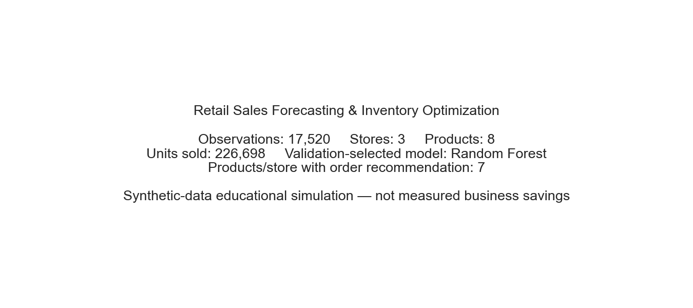
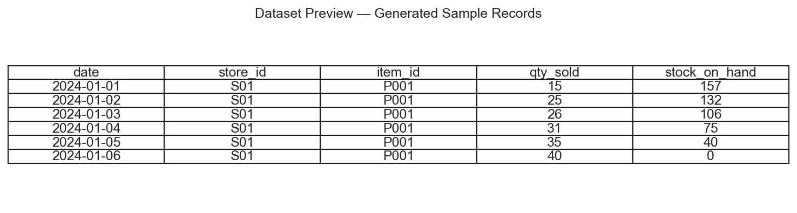
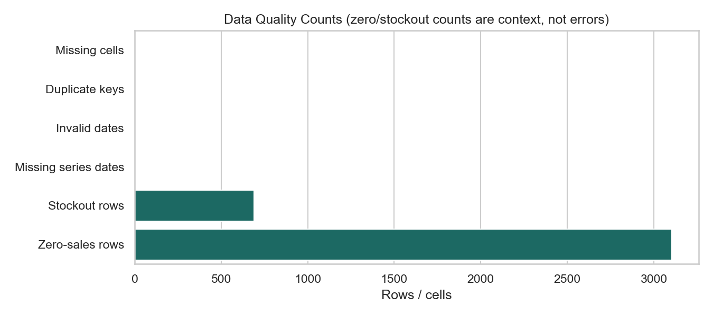
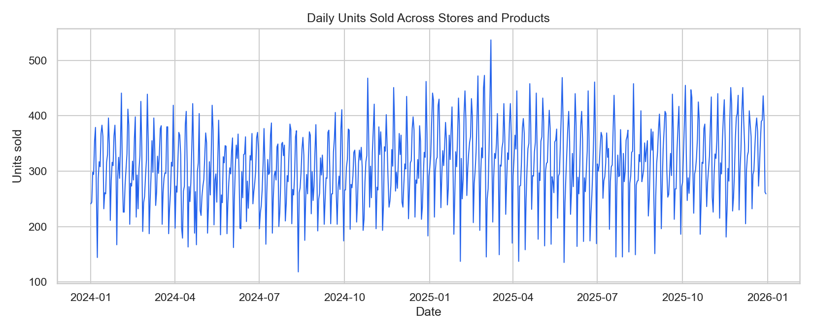
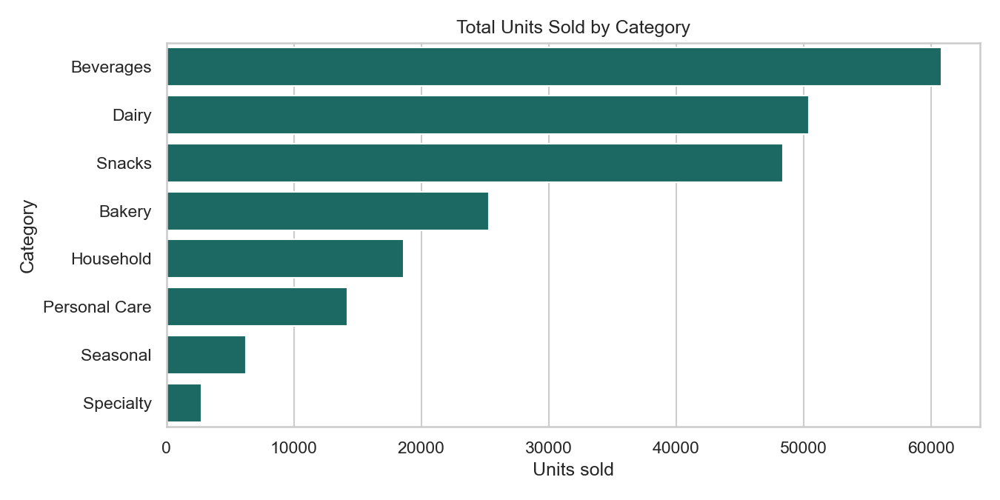
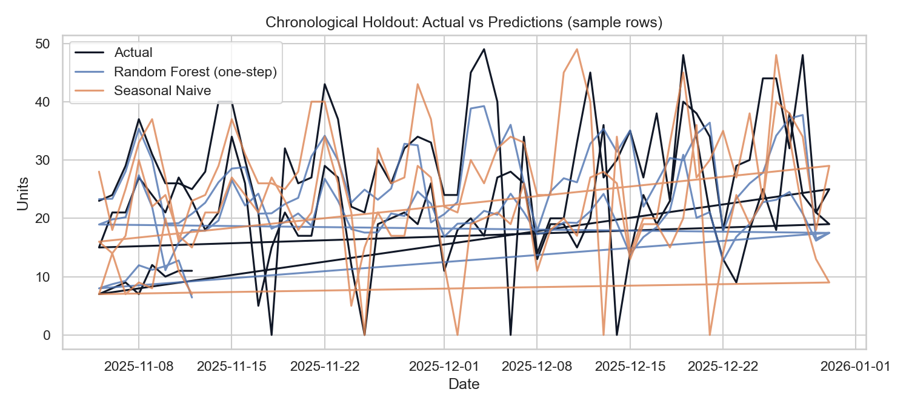
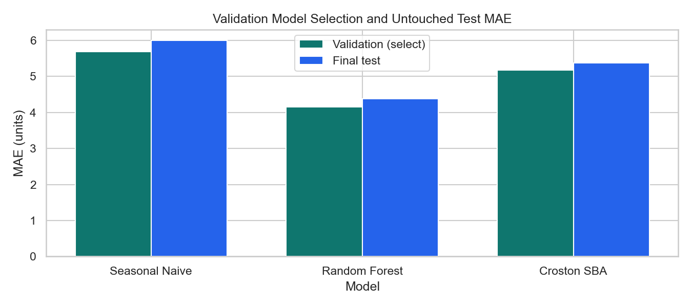
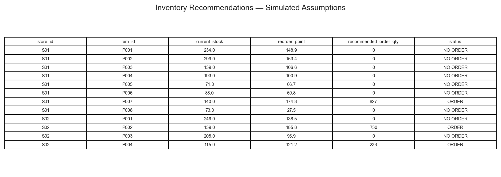
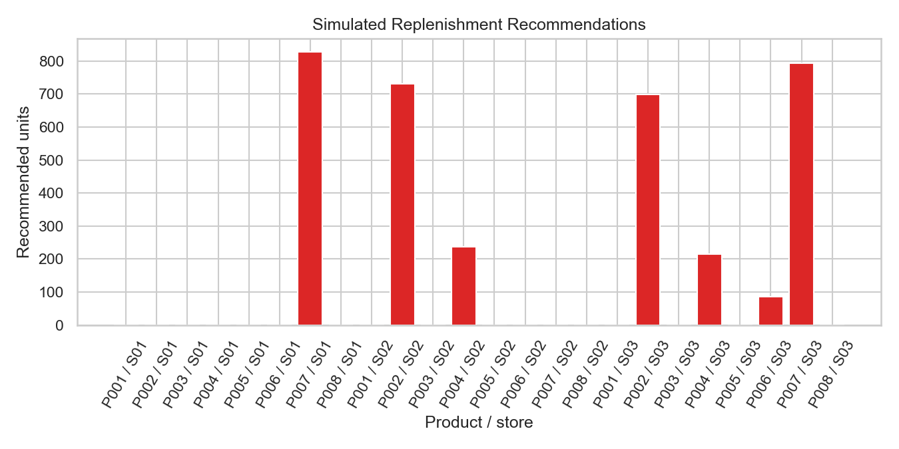
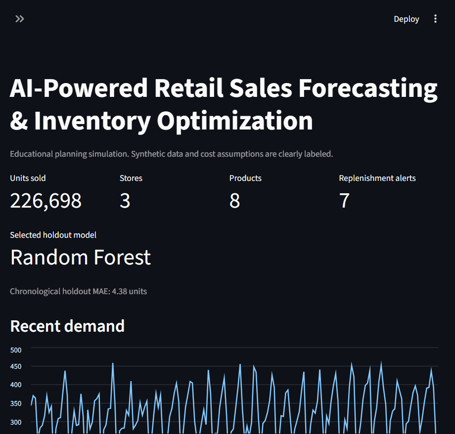
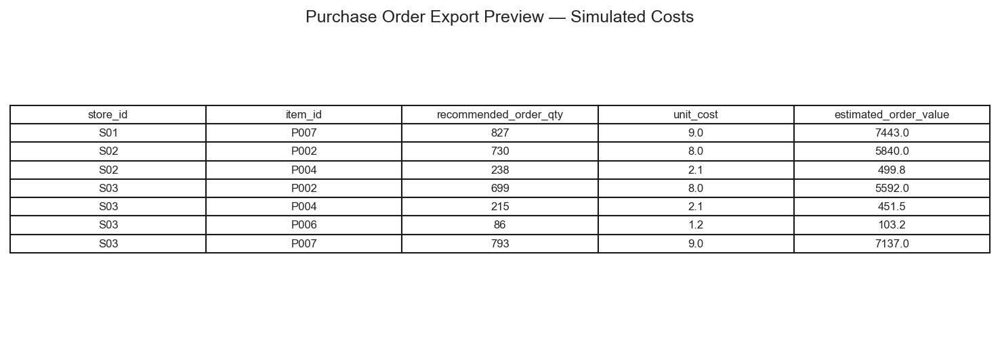
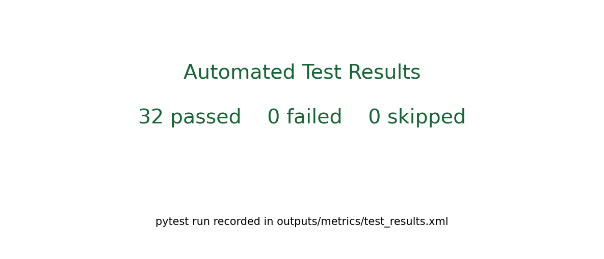

Sample output locations: `outputs/forecasts/demand_forecast.csv`, `outputs/inventory/recommendations.csv`, `outputs/inventory/purchase_order.csv`, `outputs/metrics/model_metrics.csv`, `outputs/metrics/data_quality.json`, and `outputs/figures/`.

## Limitations, privacy, license and future work

This project is for education and portfolio demonstration; it is not production-ready and must not be used as sole basis for actual purchasing. Synthetic data are not evidence of business impact. No personal data, credentials, paid API or public-data licensing claims are involved. The source code is MIT-licensed; see [LICENSE](LICENSE).

Future work could include cross-validation across multiple seasonal cutoffs, explicit censored-demand modeling, service-level calibration, direct browser-based user upload, and supplier calendars.

## Author

[Deepshikhakumari25](https://github.com/Deepshikhakumari25)
